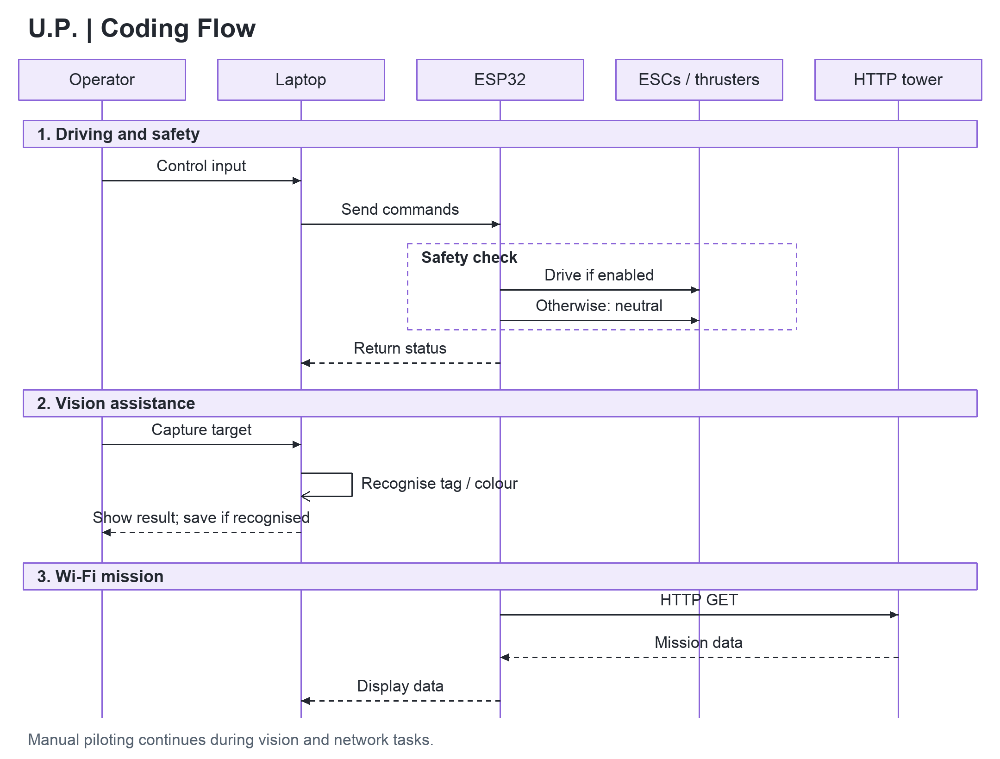

# U.P. Technical Documentation — Coding Part

**Team:** Underwater Potatoes  
**Vehicle:** U.P.

The laptop handles controller input, vision and display. The ESP32 controls the thrusters and retrieves mission data over Wi-Fi/HTTP.

## Coding flow

```mermaid
sequenceDiagram
    participant O as Operator
    participant L as Laptop
    participant E as ESP32
    participant T as ESCs / thrusters
    participant W as HTTP tower

    rect rgb(240, 235, 252)
        Note over O,W: Driving and safety
        O->>L: Control input
        L->>E: Send commands
        alt Enabled and connected; startup complete
            E->>T: Drive
        else Locked, disconnected or starting up
            E->>T: Return towards neutral
        end
        E-->>L: Return status
    end
    rect rgb(240, 235, 252)
        Note over O,W: Vision assistance
        O->>L: Capture target
        L->>L: Recognise tag / colour
        L-->>O: Show result; save if recognised
    end
    rect rgb(240, 235, 252)
        Note over O,W: Wi-Fi mission
        E->>W: HTTP GET
        W-->>E: Mission data
        E-->>L: Display data
    end
```

Manual piloting continues during vision and network tasks. A locked safety key, lost control link or startup window requests neutral; the output ramps towards neutral.

`alt` means choose one conditional branch (`if / else`).

## Artwork

[SVG vector image](output/diagrams/UP_Coding_Sequence.svg) · [PNG image](output/diagrams/UP_Coding_Sequence.png)


